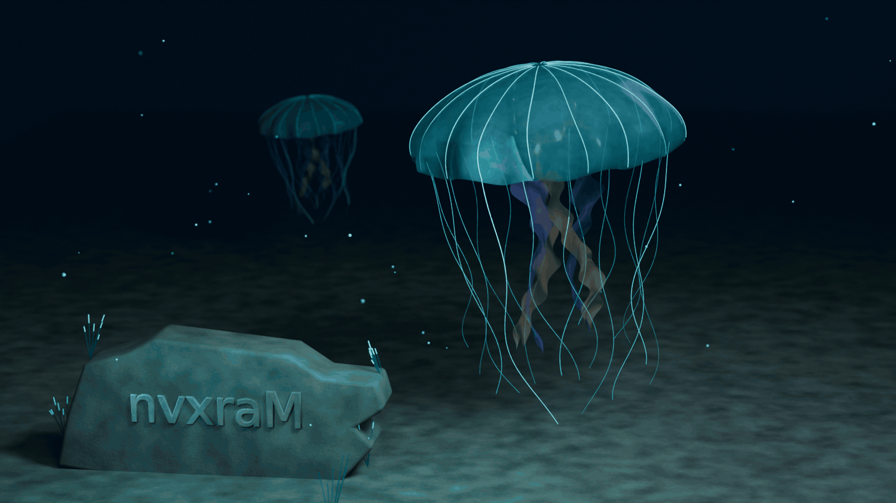

  <picture>
    <source media="(prefers-reduced-motion: reduce)" srcset="https://raw.githubusercontent.com/nvxraM/nvxraM/dd4ffbab1d425c7f93845cea2ec1bf69c2d15651/assets/panel-v6.2.png" />
    <source type="image/webp" srcset="https://raw.githubusercontent.com/nvxraM/nvxraM/dd4ffbab1d425c7f93845cea2ec1bf69c2d15651/assets/panel-v6.2.webp" />
    
  </picture>

  <a href="docs/DESIGN_HISTORY.md">Design history</a> · <a href="docs/PROFILE_STATIC.md">Still image</a>

