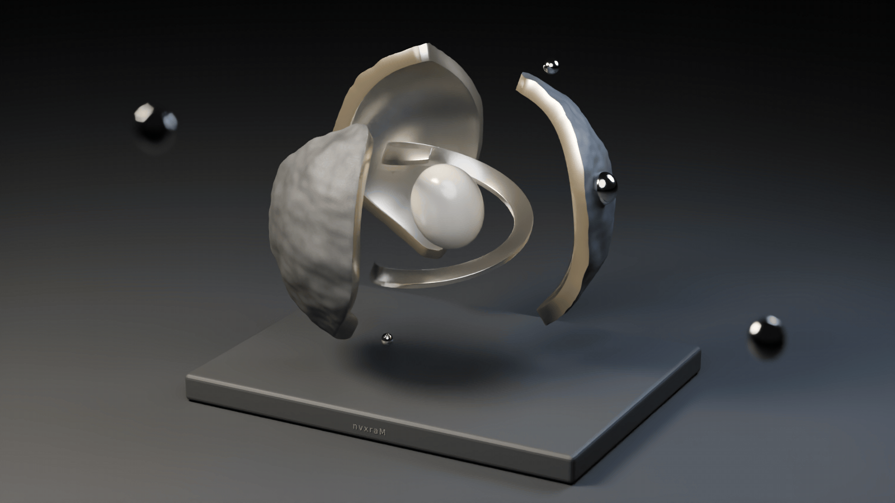
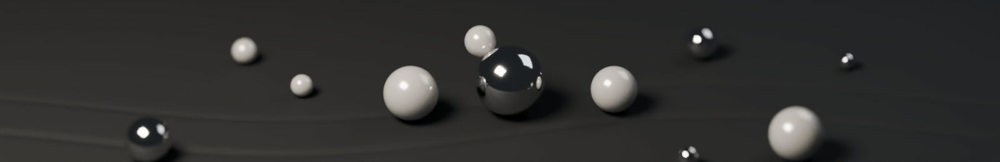

  <picture>
    <source media="(prefers-reduced-motion: reduce)" srcset="assets/hero-v3.png" />
    
  </picture>

building things. staying curious.

  <picture>
    <source media="(prefers-reduced-motion: reduce)" srcset="assets/field-v3.png" />
    
  </picture>

