# Design history

[Current profile](../README.md) · [Static profile](PROFILE_STATIC.md) · [Version index](VERSIONS.md)

This page compares the current profile with every earlier visual design recoverable from this repository: **eight historical designs and 16 original still panels**. All previews are PNG posters, so this page stays still. The snapshot links open each original layout and its animations. Historical images use full commit hashes rather than `main` or mutable asset names.

| Design | Visual direction | Original layout |
|---|---|---|
| [Current — v6.2](#current-v6-2) | PELAGIC realism; carved lettering and jellyfish identity retained | One integrated scene |
| [Initial, untagged](#initial-genomics) | Illustrated genomics and code | Four panels |
| [v1](#v1) | Minimal orbital light and flowing ribbon | Two panels |
| [v2](#v2) | Pearlescent biological sculpture and particles | Two panels |
| [v3](#v3) | Stone, porcelain and metal specimen | Two panels |
| [v4](#v4) | APERTURE metal knot and macro ribbons | Two panels |
| [v5](#v5) | PELAGIC jellyfish and marine filaments | Two panels |
| [v6](#v6) | PELAGIC relic with lettering inside the scene | One integrated scene |
| [v6.1](#v6-1) | Restrained cyan rim on the carved letters | One integrated scene |

## Current — v6.2

The current design retains the carved nvxraM relic, jellyfish geometry and camera. Less reflective, more transmitting tissue reveals the inner folds; subdued emission preserves the cyan identity. Mineral grain and roughness replace the smoother blue stone surface. Broader underwater lighting and a bounded region of distant scattering deepen the scene while keeping the lettering clear. Its versioned files keep the animated WebP, GIF fallback and reduced-motion PNG together.

  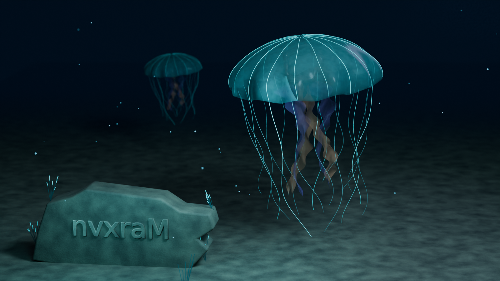

[Full-size PNG](../assets/panel-v6.2.png) · [Animated WebP](../assets/panel-v6.2.webp) · [GIF fallback](../assets/panel-v6.2.gif)

## Initial genomics — untagged

The first profile used four illustrated panels: a DNA-like helix beside “Curiosity, in code.”, a reads-to-relationships workflow, an illustrative Hi-C ordering comparison, and a terminal. Teal and lavender on dark navy established the palette. The diagrams were presented as synthetic illustrations, not research results.

[Immutable snapshot](https://github.com/nvxraM/nvxraM/tree/8db532a0b004d5c3c41c9afde3f39d01c4746f0f) · [Original README and animations](https://github.com/nvxraM/nvxraM/blob/8db532a0b004d5c3c41c9afde3f39d01c4746f0f/README.md)

  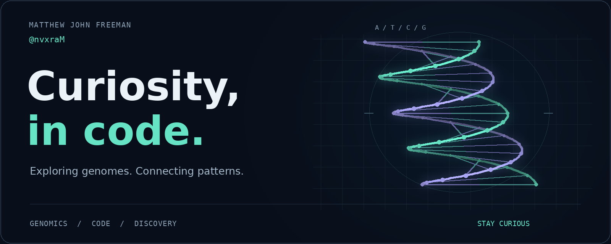

  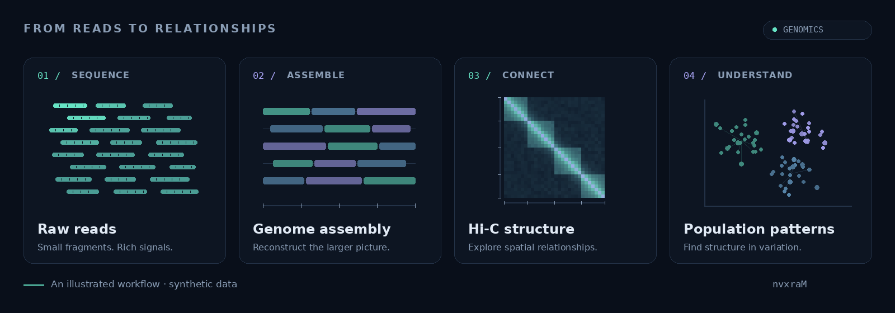

  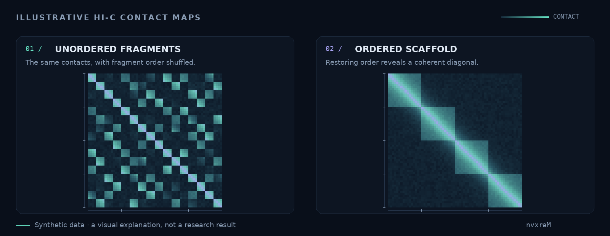

  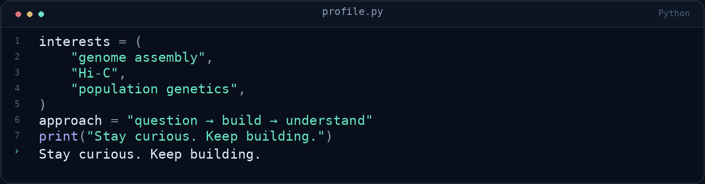

## v1 — Orbital light

The scientific dashboard gave way to a sparse luminous cyan and violet orbit, the handle nvxraM, and a narrow flowing ribbon. The page retained a short tagline between two panels. Its final tagged snapshot also removed the footer links; those README-only edits did not create another artwork design.

[Immutable snapshot](https://github.com/nvxraM/nvxraM/tree/b51ea8a335d858bd62d111d36fe4188486c50210) · [Original README and animations](https://github.com/nvxraM/nvxraM/blob/b51ea8a335d858bd62d111d36fe4188486c50210/README.md)

  

  

## v2 — Pearlescent organism

A folded pearlescent membrane surrounded a luminous molecular strand and an orbital halo. The smaller panel became a field of glowing cell-like particles. This introduced a biological form while keeping the dark canvas and two-panel arrangement.

[Immutable snapshot](https://github.com/nvxraM/nvxraM/tree/8e4e08b20680567c7e440f5dca1374a7806353d2) · [Original README and animations](https://github.com/nvxraM/nvxraM/blob/8e4e08b20680567c7e440f5dca1374a7806353d2/README.md)

  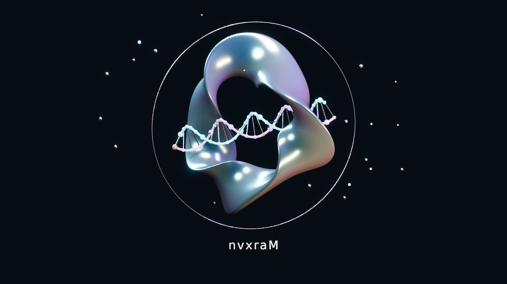

  

## v3 — Grounded specimen

The main sculpture became a fractured stone shell, porcelain core and metallic curl above a rectangular plinth. A macro still life of pearl and metal droplets formed the footer. Receiving surfaces, contact shadows, roughness and depth of field made the abstract objects feel physically staged.

[Immutable snapshot](https://github.com/nvxraM/nvxraM/tree/784a51ff394504b7ec19b848e84ec64ffa79ed57) · [Original README and animations](https://github.com/nvxraM/nvxraM/blob/784a51ff394504b7ec19b848e84ec64ffa79ed57/README.md)

  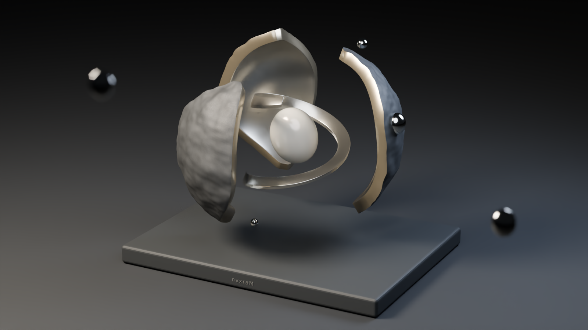

  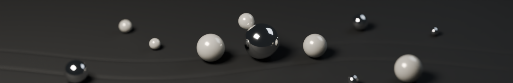

## v4 — APERTURE

The fractured specimen became a continuous champagne-metal knot with a teal underside and pale seed, floating above a round obsidian pedestal. Curled metal ribbons and scattered beads repeated the palette in the footer. The arrangement emphasized cleaner silhouettes, broad reflections and restrained amber accents.

[Immutable snapshot](https://github.com/nvxraM/nvxraM/tree/ef73d87df012367284966633a043f236367657f1) · [Original README and animations](https://github.com/nvxraM/nvxraM/blob/ef73d87df012367284966633a043f236367657f1/README.md)

  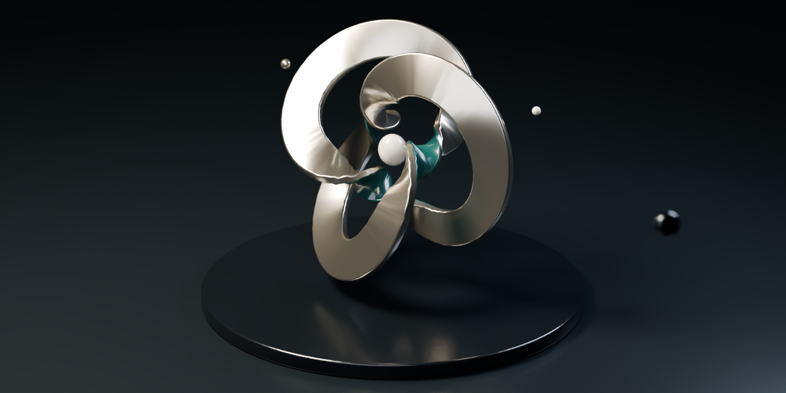

  

## v5 — PELAGIC

The metal gallery moved underwater. A translucent cyan jellyfish, warm and violet inner folds, trailing tentacles, a distant organism and suspended particles established PELAGIC. A separate luminous marine-filament panel remained below the hero; the handle and “curiosity runs deep.” appeared as page text.

[Immutable snapshot](https://github.com/nvxraM/nvxraM/tree/2d0779515a707fd0f86f3ed679299bede050536f) · [Original README and animations](https://github.com/nvxraM/nvxraM/blob/2d0779515a707fd0f86f3ed679299bede050536f/README.md)

  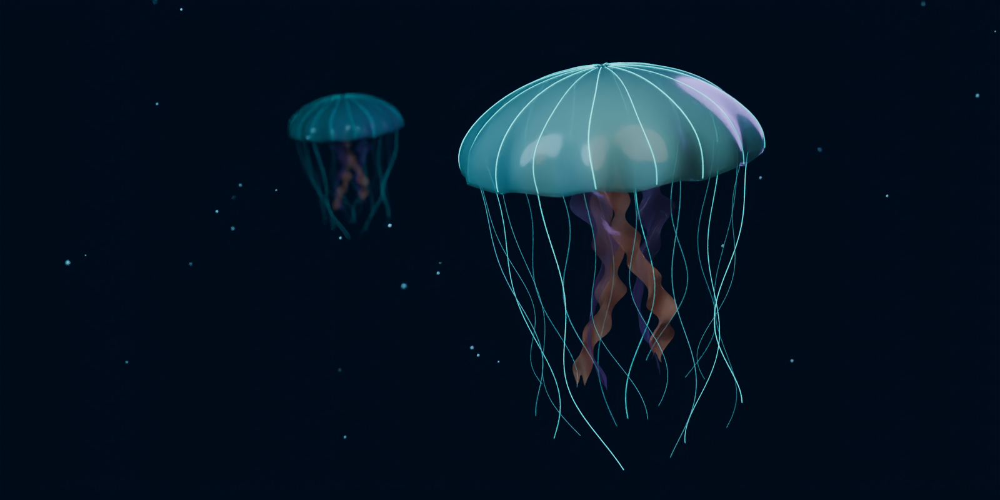

  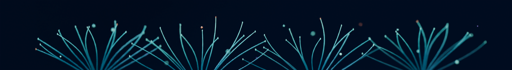

## v6 — PELAGIC / THE RELIC

The hero and footer were replaced by one continuous underwater scene. A partly buried stone relic carried nvxraM as actual bas-relief geometry, surrounded by filaments and a sloped seafloor. The jellyfish retained its identity and gained a darker folded internal organ. The handle now belonged to the scene rather than the page layout.

[Immutable snapshot](https://github.com/nvxraM/nvxraM/tree/ab99bac47591173ef9242dc4531dbedede61978b) · [Original README and animations](https://github.com/nvxraM/nvxraM/blob/ab99bac47591173ef9242dc4531dbedede61978b/README.md)

  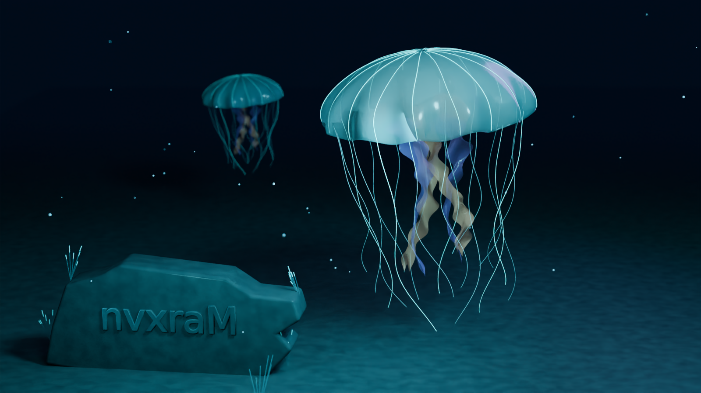

## v6.1 — Carved-letter rim

The composition, geometry and jellyfish remained. A restrained cyan light linked to the carved lettering clarified its bevels without changing the surrounding scene lighting. The difference from v6 is deliberately small and is easiest to see by opening the original-size stills.

[Immutable snapshot](https://github.com/nvxraM/nvxraM/tree/51d859a966232bef86c59585cbdabe6d22e1687a) · [Original README and animations](https://github.com/nvxraM/nvxraM/blob/51d859a966232bef86c59585cbdabe6d22e1687a/README.md)

  

## What the history can establish

The initial genomics design has no release tag; it is preserved by its original commit. Tags `v1` through `v6` and `v6.1` identify the later historical designs. Before v6.2, the reachable repository history contains eight historical commits that change artwork assets; the additional README-link cleanup, privacy-document edits and v6.1 source-pinning correction are not separate visual designs.

The 16 historical PNGs above were read from their Git objects, visually inspected, and checked against the publicly served commit-pinned files. This documents published repository history, not uncommitted experiments or designs whose sources are absent from that history. Original-size stills and snapshot READMEs preserve details that a scaled preview cannot show.
