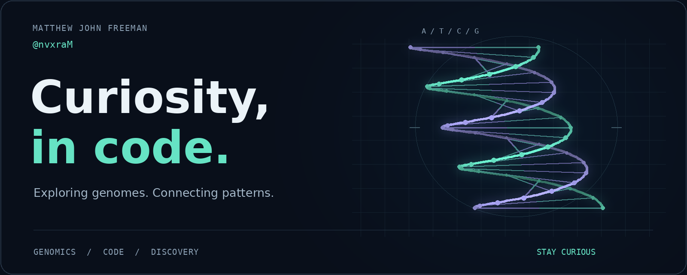
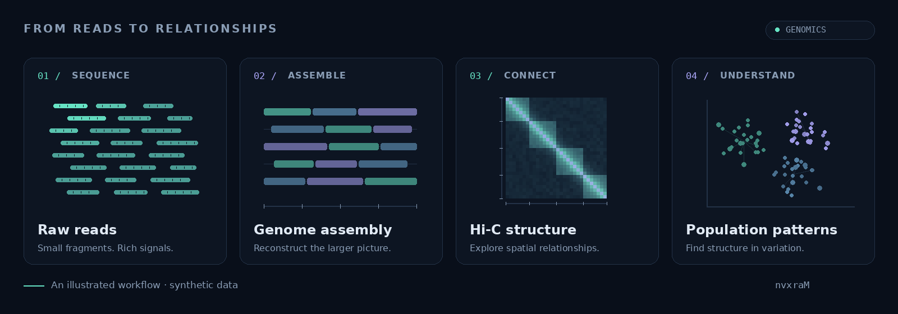
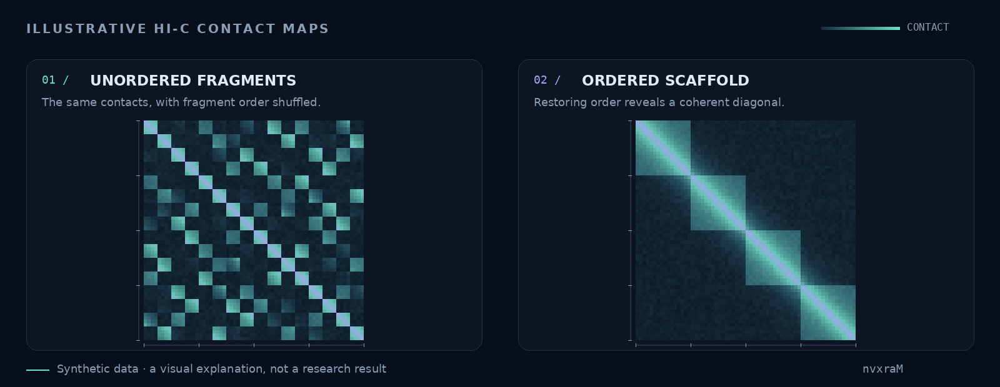
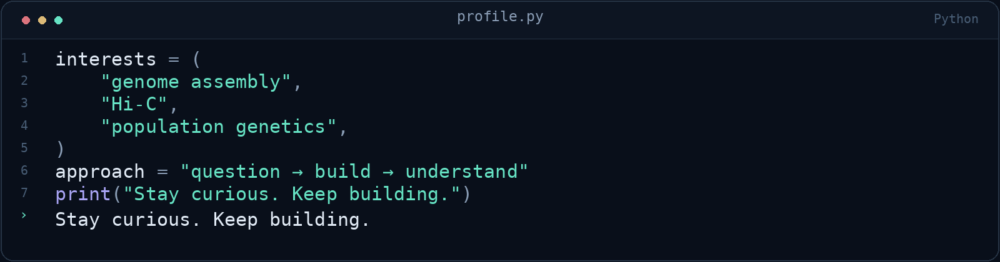

  <a href="../README.md">Back to animated profile</a>

  

# Hi, I'm Matthew.

I'm interested in the space where **genetics meets code**: exploring complex data, connecting patterns, and making ideas easier to understand.

Genome assembly, Hi-C, and population genetics are the threads that bring this profile together. I like following a good question from the first fragments to the bigger picture.

[Explore my repositories](https://github.com/nvxraM?tab=repositories) &nbsp; · &nbsp; [About this profile](PROFILE_DESIGN.md)

## From reads to relationships

  

| What draws me in | The question behind it |
| :--- | :--- |
| **Genome assembly** | How do small fragments become a coherent genome? |
| **Hi-C & genome structure** | What can physical proximity reveal about how a genome fits together? |
| **Population genetics** | What do shared patterns tell us about diversity and relationships? |

<strong>A closer look at Hi-C</strong>

 

In a Hi-C contact map, brighter pixels represent more contacts between regions. Reordering the same fragments can reveal a clearer diagonal and help assess an assembly's structure. These maps use synthetic data to illustrate the idea.

## At the keyboard

  

---

  Good questions. Clear code. Better understanding. 
  Original, repository-hosted graphics. All scientific visuals are illustrations using synthetic data.

